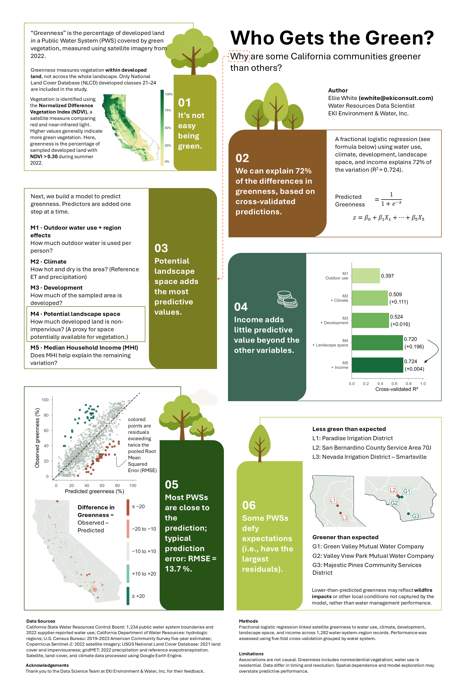

# California Water Data Challenge

[View the poster (PDF)](outputs/infographic_v3.pdf) · [Download the editable poster (PowerPoint)](outputs/infographic_v3.pptx)

## Project overview

This study examines how satellite-observed greenness on developed land varies across California public water systems (PWSs), and how it is associated with residential outdoor water use, climate, development, potential landscape space, and income.

The retained model includes **1,282 PWS-region records from 1,234 unique PWSs**. Its five-fold cross-validated \(R^2\) is **0.724**. This is exploratory predictive performance—not an independent test, a causal estimate, or a measure of water-use efficiency.

### What “greenness” measures

Greenness is the fraction of valid pixels in NLCD-developed areas (classes 21–24) with Sentinel-2 summer 2022 NDVI greater than 0.30. It is not a direct measure of irrigation, irrigable land, lawn area, or landscape quality. Developed areas include nonresidential land such as parks and commercial or institutional landscapes.

The model’s “potential landscape space” predictor is the non-impervious share of developed land. It is a broad proxy, not a measure of irrigable area or nonfunctional turf covered by California’s turf restrictions.

## Code and reproduction

The R scripts download and process data, build analysis tables, fit models, and create figures. Python scripts use Google Earth Engine for satellite and climate summaries. Detailed methods, setup instructions, assumptions, archived experiments, and workflow status are in the [lab notebook](LAB_NOTEBOOK.md).

Some steps require Census API credentials or access to the configured Earth Engine project. **Never commit credentials.** Generated files under `outputs/` are ignored, except for the V3 poster PDF and PowerPoint; analysis outputs must be regenerated by running the documented workflows.

Water-use retrieval currently requires selecting and configuring a data.ca.gov CSV URL; the lab notebook documents this manual step.

## Data and interpretation

Inputs include California water-system boundaries and supplier-reported water use, ACS block-group estimates, Sentinel-2 imagery, GRIDMET climate data, and NLCD land-cover data. See the [lab notebook](LAB_NOTEBOOK.md) for source details and processing steps.

Water use is supplier-wide, while greenness and several covariates are summarized over sampled block-group/service-area overlaps. The study covers one year, has incomplete spatial extraction and varying supplier-data coverage, and does not establish that water use caused observed greenness. Read the limitations before interpreting or comparing results.

## Reuse

No project license or formal citation instructions are included yet. Before release, clarify code licensing and how to cite the work with the project owner. Public visibility alone does not grant reuse rights; follow the licenses and terms for each source dataset.
